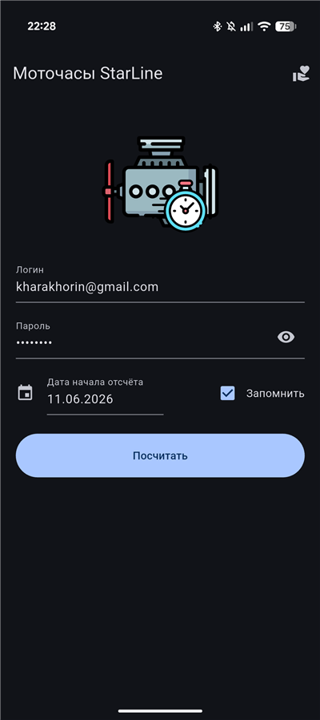
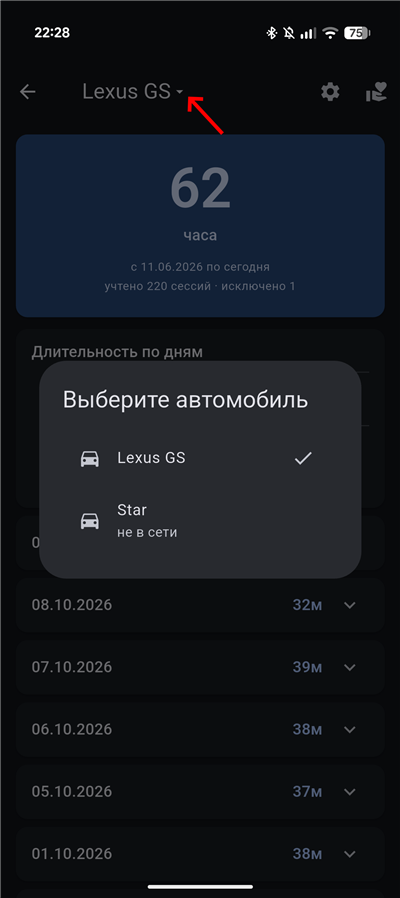
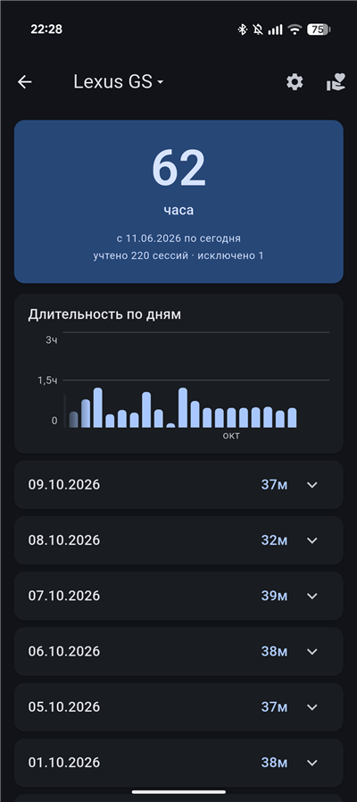
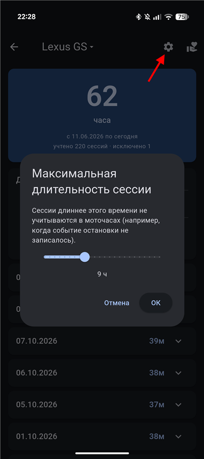

# Моточасы StarLine

Приложение под Android для вычисления моточасов с помощью API StarLine Телематика

  

Подробное описание и обсуждение — на DRIVE2: [Моточасы StarLine 2.0](https://www.drive2.ru/l/745315777711702304/)

  
  
  
  

